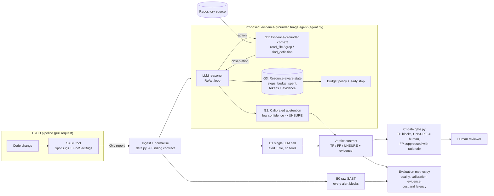

# Architecture

The three selected gaps are marked directly in the proposed system:

- **G1**: a verdict must be supported by repository evidence gathered with read-only tools.
- **G2**: uncertain alerts are not silently suppressed; the agent abstains and routes them to a human.
- **G3**: tool use and model calls are controlled by an explicit budget and recorded for audit and cost analysis.

The two baselines make the research comparison explicit. B0 blocks on every raw SAST alert, while B1 makes one model call with no tools. The proposed path adds adaptive tool use, evidence, abstention and budget-aware stopping before the same CI gate.
